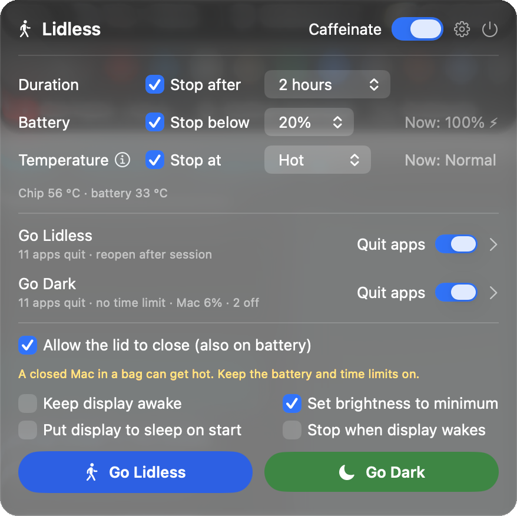

# Lidless

A small macOS menu bar app that keeps your Mac awake, also with the lid closed,
and stops by itself before the battery runs out or the Mac gets too hot.

Use it when a coding agent (Claude Code, Codex, …) must keep working while the
laptop is in your bag. It is a free, open-source take on the idea behind
[SleepWalk](https://sleepwalk.app).



## Features

- **Two buttons**:
  - **Go Lidless** starts a session with the limits in the panel. Use it when
    the Mac works in your bag.
  - **Go Dark** is for the night at your desk. It makes the displays dark and
    runs without a time limit by default.
- **Guardrails**: a session stops after a time, below a battery percentage
  (on battery only), or at a heat level (Warm, Hot, Critical).
- **Temperatures**: the panel shows the chip and battery temperature in °C
  (Apple silicon), and warns when the Mac is too warm to close in a bag.
- **Lid closed**: optional. Uses `pmset -a disablesleep 1` and restores the
  previous setting when the session ends, when the app quits, and when the app
  crashes.
- **Quit apps**: Go Lidless and Go Dark each have a list of apps to quit at
  the start and to reopen at the end. A "Quit apps" switch in the panel keeps
  every app open for one session.
- **Go Dark displays**: choose one of two modes in Settings > Go Dark.
  - **All displays sleep** (`pmset displaysleepnow`). Any key wakes all of
    them. With a dock, this can lock the screen and reset USB devices.
  - **A setting for each display**. The Mac screen stays on at a brightness
    from 6% to 100%, so the brightness key works at once. Each external
    display can **turn off** (the monitor goes to standby, as with a pulled
    cable), go black, or dim. A watchdog turns the displays on again if
    Lidless crashes.
- **Caffeinate switch**: runs `/usr/bin/caffeinate` until you switch it off.
  Choose the flags (default `-dimsu`) and an optional time limit.
- **Command line and agent skill**: `lidless start/stop/status`, so a coding
  agent can start a session with limits and stop it when its work is done.
- Notifications when a session starts or stops, with the reason.
- Settings window: open at login, lid permission, update check, logs, agents.

## Install

Requires macOS 13 or later. Apple silicon and Intel.

### Download

1. Download `Lidless-<version>.zip` from the
   [latest release](https://github.com/Ruelled/lidless/releases/latest) and open it.
2. Move `Lidless.app` to your Applications folder, then open it.
3. Releases from 0.10.1 are signed with Developer ID and notarized by Apple,
   so the app opens without a warning. To check where a download was built:
   `gh attestation verify Lidless-<version>.zip -R Ruelled/lidless`
4. For the `lidless` command, open Lidless **Settings > Agents** and click
   **Install**.

A downloaded copy checks GitHub Releases for updates. To update, quit Lidless
and replace the app with the new one.

### Build from source

```sh
git clone https://github.com/Ruelled/lidless.git
cd lidless
./build.sh            # builds Lidless.app into ~/Applications and `lidless` into ~/.local/bin
open ~/Applications/Lidless.app
```

You need the Xcode Command Line Tools (`xcode-select --install`). The app is
built on your Mac and signed ad hoc, so Gatekeeper does not block it.

To update: `git pull && ./build.sh`, then quit Lidless and open it again.
Settings > General can check GitHub for a newer commit once a day. That is
the only network request Lidless makes.

## Heat safety

Settings > Safety explains the four macOS heat levels (Normal, Warm, Hot,
Critical), when heat is a risk for a Mac, and holds the heat limit. Hot is the
default and the recommended level. To turn the limit off, you must confirm.
The limit is also a ceiling for the command line: an agent can make it
stricter, not weaker.

## Command line

```sh
lidless start --duration 2h --battery-floor 20 --thermal-stop hot [--lid] [--by codex]
lidless status            # add --json for machine output
lidless stop
lidless caffeinate on [--flags di] [--for 2h]   # flags and time for this run only
lidless caffeinate off
lidless settings [general|safety|caffeinate|lid|cleanup|agents]
```

Options that you leave out come from the saved panel settings. `start` opens
Lidless if it is not running. Durations are at most 24 hours. Exit codes: 0
success, 1 failure, 2 usage error.

**Several agents.** When a session is active, `start` joins it: each `--by`
name becomes a holder, and the end time moves later if needed. `stop --by
<name>` removes one holder, and the session ends when no holder is left.
`stop` without `--by` ends it for everyone. Go Lidless never quits the app
that sent the command, for example the agent's terminal.

The command and the app talk through a distributed notification (local
processes only) and the state file
`~/Library/Application Support/Lidless/state.json`.

## Agent skill

[`skill/SKILL.md`](skill/SKILL.md) teaches an agent when and how to use
`lidless`. Install it for Claude Code, Codex or `~/.agents` in Settings >
Agents, or copy the setup prompt for any other agent. Then tell the agent
"do not let the Mac sleep" or "I will close the lid".

## How the lid-closed mode works

macOS always sleeps when you close the lid on battery power, unless sleep is
disabled for the whole system with `pmset -a disablesleep 1`. That command
needs root. When you click **Grant…** for the first time, Lidless asks for
your admin password once and writes `/etc/sudoers.d/lidless`:

```
<you> ALL=(root) NOPASSWD: /usr/bin/pmset -a disablesleep 0, /usr/bin/pmset -a disablesleep 1
```

The rule lets only your user run only those two exact commands. Click
**Remove lid permission** in the panel, or run
`sudo rm /etc/sudoers.d/lidless`, to remove it.

Safety nets for `disablesleep`:

1. A session ends at its time, battery or heat limit, and sleep is enabled again.
2. When Lidless quits, it ends the session.
3. If Lidless crashes or is force-quit, a small background shell sees that the
   process is gone and runs `pmset -a disablesleep 0`.
4. At start, Lidless undoes a `disablesleep` that it left behind.

If `SleepDisabled` was already `1` before a session, Lidless leaves it at `1`.
Logs: `~/Library/Logs/Lidless/lidless.log`.

To check by hand: `pmset -g | grep SleepDisabled` must show `0` when no
session is active. To fix it by hand: `sudo pmset -a disablesleep 0`.

## Warning

A closed laptop in a bag gets hot. Keep the battery and time limits on. The
temperature limit uses the macOS thermal state, and the Mac usually slows
itself down before it reports "Hot", so do not rely on that limit alone.
Check the temperatures in the panel before you close the Mac in a bag. Use
this software at your own risk; see the [license](LICENSE).

## Testing

```sh
./test.sh               # unit tests; change nothing on the Mac (also run in CI)
./build.sh && Tests/integration.sh   # real sessions against the installed app
```

The integration tests refuse to run while a session or caffeinate is active.
With the lid permission, they also crash the app on purpose and check that
`SleepDisabled` returns to `0`.

## For agents

See [AGENTS.md](AGENTS.md) for build commands and shell checks of the state.

## License

MIT. See also [CHANGELOG.md](CHANGELOG.md) and [SECURITY.md](SECURITY.md).
